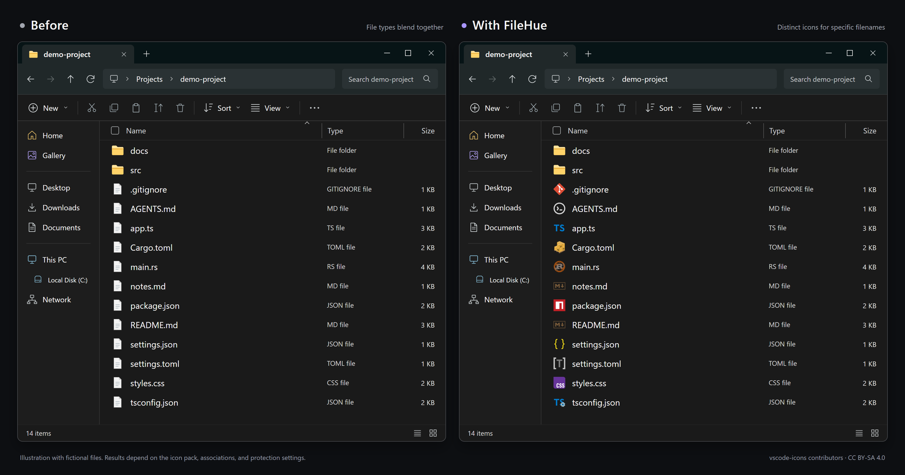

# FileHue

English | [日本語](README.md)

A Rust application that brings VS Code file icon themes to Windows 11 x64 File Explorer. Icons are selected by filename and extension while preserving file contents and default applications.

[v0.1.0 is available](https://github.com/YukiWorks432/FileHue/releases/tag/v0.1.0). Download the unsigned Windows x64 ZIP and `SHA256SUMS.txt` from the release page. Start with the [usage guide](docs/usage.en.md), or read the [initial release overview](docs/releases/0.1.0.en.md) for features and limitations. Find other versions on [GitHub Releases](https://github.com/YukiWorks432/FileHue/releases). Developers preparing distributions should follow the Japanese [distribution guide](docs/distribution.ja.md).

Illustration with fictional files using vscode-icons 13.0.0. Results depend on the icon pack, associations, and protection settings. See the [image credits and terms](docs/assets/explorer/NOTICE.md).

## Features

- Download reviewed icon packs, preview the results and licenses, then apply a pack from the GUI.
- Choose vscode-icons, Material Icon Theme, Catppuccin Icons, Symbols, or VSCode Great Icons, or import an unpacked local VS Code extension.
- Use dedicated icons for Cargo.toml, package.json, and README.md when the theme defines them. Rules also apply to newly created and renamed files.
- Choose file types and protect existing icons by software provider or extension. `.lnk` and `.exe` always retain their existing icons.
- Switch packs, restore the original registrations, or use the auxiliary CLI. Japanese and English interfaces are available.

Downloading a pack does not apply it. Applying changes icon registrations for the current Windows user. Read the [usage guide](docs/usage.en.md) first. Existing-icon protection is enabled by default; protected types do not receive pack icons.

## Documentation

Start with the [usage guide](docs/usage.en.md) for setup, application updates, restoration, and removal, or see the [CLI reference](docs/cli.en.md). The [documentation index](docs/README.md) links to specifications and development guides, currently maintained in Japanese. The [changelog](CHANGELOG.md) starts with the first public release.

## Development

Install the Windows MSVC toolchain, Rust, PowerShell 7.4 or later, and [just](https://just.systems/man/en/). Install just with `cargo install just --locked` and list recipes with `just --list`.

| Command | Purpose |
| --- | --- |
| `just run` | Build the GUI and Shell DLL in release mode and launch the GUI |
| `just run-debug` | Launch a debug build |
| `just cli --help` | Show auxiliary CLI help |
| `just verify` | Run formatting checks, static analysis, builds, interaction and contract tests, and startup verification |
| `just audit` | Audit dependencies and exception deadlines with pinned cargo-deny before compiling the application |
| `just licenses` | Generate third-party notices, license selections, and an offline HTML document |
| `just check-binaries --folder <directory>` | Check distribution EXEs and DLLs for embedded build paths |
| `just package` | Create a validation ZIP; add `--public-candidate` to prepare a public release candidate |

Install the audit tool in advance with `cargo install cargo-deny --version 0.20.2 --locked`. Run `just audit` before compiling candidate dependency updates; see the Japanese [dependency policy](docs/dependency-security.ja.md).

Launching the GUI does not change Shell registration. Normal GUI and CLI commands use your settings. `just smoke` and automated tests use isolated locations. See the Japanese [development guide](docs/development.ja.md) for commands, test boundaries, and distribution checks, and [CONTRIBUTING](CONTRIBUTING.md) before making changes.

## License

Notice generation uses cargo-about 0.9.2. Install it with `cargo install cargo-about --version 0.9.2 --features cli --locked`. The Japanese [distribution guide](docs/distribution.ja.md#権利表示の収集範囲) describes the scope of generated information, original notices, and source archives.

The application uses the [MIT License](LICENSE). External packs, dependencies, and language mappings retain their own terms; see [third-party notices](THIRD_PARTY_NOTICES.en.md). Icon packs for use by the application are downloaded separately. Artwork in the README illustrations is covered by the [image notices](docs/assets/explorer/NOTICE.md). The application's MIT license does not grant blanket redistribution rights for external assets.

In a distribution build, open the application and select “About” to view FileHue's license and third-party licenses. See the Japanese [development guide](docs/development.ja.md#権利表示の生成) for preparing these files in a development build.
