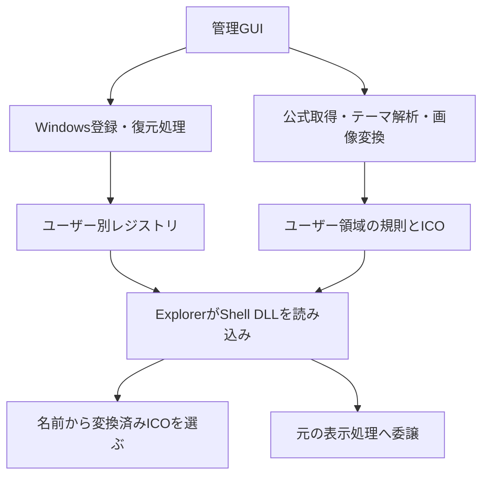

# 現行仕様の解説

Windows 11の標準エクスプローラーへファイルアイコンテーマを適用する仕組みを、利用者の操作と内部処理から説明します。[要求仕様](requirements.ja.md)が要求の正本、[適用対象と保護](target-selection.ja.md)と[競合復旧](conflict-recovery.ja.md)が詳細な操作契約です。利用手順は[使い方](usage.ja.md)、開発時の確認は[開発と検証](development.ja.md)を参照します。

## 対象と基本の流れ

対象はWindows 11 x64、現在のWindowsユーザーです。適用中のテーマは一つとし、ファイルの内容・既定アプリ・起動コマンドを変更しません。対応画像はSVG、PNG、JPEG、ICOであり、取り込み時にWindows用ICOへ変換します。

基本の流れは「取得または取り込み → 見本と利用条件の確認 → 明示的な適用」です。取得しただけでは表示を変更しません。テーマに定義がある場合、Cargo.tomlとsettings.toml、package.jsonとdata.json、README.mdとnotes.mdを区別します。画像の違いをアプリが独自に補うものではありません。

## GUIと補助CLI

上部には言語・外観、適用状態・復元、取得済み／パックを探すの二択と独立した取り込み操作を置きます。主要操作を固定し、一覧だけをスクロールします。パックは独立したカードとし、見本と利用条件はそのカード内へ表示します。選択中の画面は主要色・チェック・太字で示します。

対象編集ではカテゴリ、検索、複数選択と一括変更、比較、コピーを使います。下書きの保存と適用は明示操作とし、切り替えや開閉だけで登録を変更しません。適用中のパックで選択を保存すると、変更前の状態を退避して再適用します。

保護画面ではソフトのアイコン・名前を持つアコーディオンを一つの一覧カードへまとめ、複数同時に開閉します。「すべて開く」「すべて閉じる」を操作列に置きます。保護中とパック許可の種類を一覧に残し、保存済みの指定、現在と保存後の代表的な表示を区別します。提供元・種類のそれぞれで方針を選べます。個別指定が提供元指定に優先し、未指定なら共通設定を継承します。共通保護設定の切り替えでは画像を再抽出せず、外部変更は再調査で確認します。

補助画面の戻る、Alt＋←、マウスの戻るは同じ移動へ接続します。対象編集の下書きは保持し、保護編集は未保存の変更を破棄して戻ります。保存中の移動制限とフォーカスは[UI規約](ui-design.ja.md)に従います。補助CLIは[CLI仕様](cli.ja.md)に定めた出力・終了コード・確認手順を使い、GUIと管理処理を共有します。

## 公式パックの取得と更新

現在の確認済み一覧は次のとおりです。これは確認した配布物の固定一覧であり、上流の最新バージョンの一覧ではありません。

| パック | 固定した版 | 追加されるテーマ |
| --- | --- | --- |
| vscode-icons | 13.0.0 | vscode-icons |
| Material Icon Theme | 5.39.0 | Material Icon Theme |
| Catppuccin Icons | 1.26.0 | Mocha、Latte、Frappé、Macchiatoの四つ |
| Symbols | 0.0.7 | Symbol Icons |
| VSCode Great Icons | 2.1.116 | VSCode Great Icons |

取得元は作者のGitHubリリースのVSIXです。VSCode Great IconsはVSIXの添付がないため、v2.1.116が指す固定コミットの公式ソースZIPを使います。アプリはテーマ定義、画像、権利表示を読み取るだけで、JavaScriptや導入用スクリプトを実行しません。任意URLの入力やVisual Studio Marketplace APIからの取得は提供しません。

Great Iconsの確認済みソースに含まれる `icons/pnpm.svg` と `icons/singularity.svg` だけは、既知の標準SVG 1.1外部DTD宣言を文字列として除去してから通常の画像検査へ渡します。DTDの取得や解析は行わず、ほかのDTDと通常の手元の取り込みは従来どおり拒否します。出典の `download.normalizations` に対象パス、処理名、処理前後の画像ハッシュを保存します。

取得後にSHA-256を照合し、展開後も発行者、パッケージ名、版、テーマ識別子を確認します。SHA-256の固定は、保守者が確認した配布物と同じかを確認する仕組みであり、作者の電子署名ではありません。

進捗には「ダウンロード中」「検証・展開中」「アイコンを変換中」と取得バイト数を表示します。完了率や残り時間を正確に予測する表示ではありません。「キャンセル」は中断を要求し、その後は「キャンセルの完了を待っています…」を表示します。読み取りや項目処理、変換の合間に中断を確認するため、通信待ちや一つの画像処理が即座に止まるとは限りません。

変換中は、使用する画像定義の完了件数と総数、現在のテーマ番号とテーマ数、処理全体の経過時間も表示します。同じ定義への参照は一件と数え、画像件数はテーマごとに切り替わります。画像が全件完了した後にも整合性検査と保存が残ります。

取得に失敗した場合は詳細を確認して再試行できます。「再試行」は失敗した取得対象だけに表示します。失敗、中断、取得成功だけでは適用状態を変更しません。管理画面を閉じた場合も中断を要求し、背景処理が終了するまでは同時変更を防ぐロックを保持します。

更新は、アプリの確認済み一覧に新しい版が掲載された場合に限ます。古い版が保存されていれば「更新をダウンロード」を表示します。新しい版は以前の版と別に保存し、利用者が適用するまで切り替えません。上流の更新の自動検出や自動適用は行いません。

同じ提供元・拡張・テーマの別版が取得済みなら、パック内の「別バージョンの設定を確認…」から対象設定を下書きへ引き継げます。一致・追加・削除の件数と対象名を確認でき、新版だけの対象への指定と旧版の保存値を保持します。引き継ぎは取り消せ、保存・適用は明示操作です。

パックの見本は保存済みの対象選択を反映しますが、既存アイコンの保護を含みません。各行の「表示予定を確認」から同じファイル名の比較へ移動し、保存済み・下書きそれぞれの保護を含む結果を確認できます。

## 手元のテーマの取り込みと互換性

取り込みでは、`package.json` を含む展開済みのVS Code拡張フォルダーを選びます。`contributes.iconThemes` から候補を読み、テーマを選んで変換します。空または重複したテーマ識別子は一覧表示前と取り込み時の両方で拒否します。一つの拡張に複数テーマがある場合、手元の取り込みでは選んだ一つを扱います。公式Catppuccinの取得では四つをまとめて準備します。

ローカル取り込みでは、処理と画面が同じ中断状態を共有します。下部の「パックを確認・変換中」とスピナー、枠付きの「キャンセル」を一覧のスクロールから独立させ、日英で案内します。通信量や未計測の完了率は付けません。中断要求後は待機中の文言へ切り替え、安全な確認箇所で停止します。画面の破棄も同じ状態へ中断を要求し、背景作業が残る間は管理ロックを保持します。保存確定前の中断では、候補、既存パック、選択と適用状態を保持します。保存済みの成功結果を遅れた中断要求だけでキャンセルへ変えません。取得と取り込みの画面更新は共通のタイマーを使い、完了・画面破棄で終了します。

ファイル名、拡張子、言語識別子の規則が未定義のアイコンを参照する場合は、その規則だけを警告付きで除外します。GUIの取得済み一覧に警告件数、詳細に先頭20件を表示し、完全な記録は出典ファイルへ保存します。CLIも取得・取り込み結果に警告と `warning_count` を返し、`pack show` で出典内の全件を確認できます。既存のパックに警告欄がない場合は警告なしとして読み込みます。除外後は有効な下位規則へ進み、該当しなければWindowsの通常表示となります。規則が一つも残らないテーマや、定義済みの画像が壊れているテーマは取り込みません。

| 入力項目 | 現在の扱い |
| --- | --- |
| `iconDefinitions` / `iconPath` | 参照する画像を読み、ICOへ変換する |
| `fileNames` | 特定の名前に対応する規則として使う |
| `fileExtensions` | 拡張子の規則として使います。複合拡張子と直近の親フォルダー条件にも対応する |
| `languageIds` | 組み込み言語対応表と拡張の言語宣言から、名前・拡張子・パターンの補完規則を作る |
| `contributes.languages` | 拡張側の言語とファイル名等の対応を補完に使う |
| コメント付き定義 | UTF-8のJSON5として解析します。先頭のBOMも扱う |
| `fonts` を使うアイコン | 非対応として取り込みを失敗させる |
| フォルダー用アイコン、既定の汎用ファイル画像、`light` 等の自動切替 | 現在のファイル規則としては使用しない |

VS Codeの拡張を完全に再現する機能ではありません。拡張のプログラムで動的に生成する設定や、VS Code固有の画面状態まで適用するものではありません。画像は元の拡張フォルダー内へ解決できることを確認し、元のフォルダーは変更しません。取り込みに失敗しても選択済みテーマを保持し、同じ選択から再試行できます。

公式取得のパック識別子は `発行者.パッケージ名/テーマ識別子@版` の形で版を含みます。一方、手元の取り込みでは `発行者.パッケージ名/テーマ識別子` と別の版情報を保存します。同じ識別子の手元パックは未適用なら一覧上で置き換えられるが、適用中のパックの置き換えは拒否します。両方式を同じ更新規則と考えないことが必要です。

## ファイル名からアイコンを選ぶ規則

名前解決では、パスの区切りを統一し、Unicodeの小文字化で比較します。これはWindowsのすべての文字比較規則を完全再現するものではありません。直接指定の規則が、言語識別子から生成した補完規則に優先します。

| 優先順位 | 照合する規則 | 例 |
| ---: | --- | --- |
| 1 | 直近の親フォルダーを含むファイル名 | `src/package.json` |
| 2 | ファイル名 | `package.json` |
| 3 | 直近の親フォルダーを含む拡張子 | `src/test.ts`、`src/ts` |
| 4 | フォルダー条件のない拡張子 | `test.ts`、`ts` |
| 5 | 言語の補完規則にあるファイル名 | 言語宣言に含まれる特定名 |
| 6 | 言語の補完規則にあるファイル名パターン | 言語宣言の `filenamePatterns` |
| 7 | 言語の補完規則にある拡張子 | テーマの `languageIds` と言語対応表から生成 |
| 8 | テーマで扱わないファイル | 元のアイコンハンドラーまたは通常の画像位置へ戻す |

拡張子は各段階で長いものから調べます。たとえば `sample.test.ts` は `test.ts`、`ts` の順になります。親フォルダー付きの拡張子の段階を先に終えてから、フォルダー条件のない拡張子を調べます。このため、親フォルダー付きの短い規則が、通常の長い規則に優先する場合があります。

完全一致名・拡張子の親フォルダー条件は直近の一階層だけを扱います。言語のglobも評価対象を同じ範囲に限定し、`/` のないパターンにはファイル名、`/` を含むパターンには「直近の親/ファイル名」を渡します。親のない入力ではファイル名だけを渡します。区切りを統一し、小文字化した入力を使います。`config/*.wfi-test` は直近の親がconfigの場合に一致し、`**/rebase-merge/done` は直近の親がrebase-mergeの場合に一致します。任意の祖先フォルダーは調べず、`**/.github/hooks/*.json` のように複数の親階層が必要な規則は引き続き対応範囲外です。パターンが複数一致した場合は内部のキー順で先に一致したものを使います。独自の「より具体的なパターンを優先する」採点は行いません。

取り込み時に小文字化後の同じキーへ異なる画像が割り当たればエラーにし、同じ画像の別表記は統合します。言語のファイル名パターンも対象とし、複数の言語宣言に同じ原文パターンがあっても上書きで矛盾を隠しません。異なる画像識別子でも素材の内容が同じなら統合できます。規則の置換と保存済みテーマの読み取りでも矛盾を拒否し、失敗した置換は元の規則と解決結果を保持します。登録済みの規則が指す生成画像が失われた場合は、その規則から別の低順位のテーマ画像を探し直さず、通常表示の経路へ戻ります。

TOML、YAML、Zigについては、組み込み言語対応表に足りない拡張子を本アプリの初期要件に基づいて補います。ファイル本文を読んで言語を推定する処理は行いません。

## Windowsへの登録と表示の仕組み

既存アイコンの保護は既定で有効です。画像指定や専用ハンドラーのある種類を保護し、上部の「アイコンの保護」で保存済みの指定と現在・保存後の見本を確認できます。提供元別の一括指定と拡張子別の例外を編集でき、既存画像とパック画像を比較できます。登録が変わった許可は再確認し、共有クラスでも拡張子ごとの指定を独立して適用します。以下のテーマ登録・委譲は保護されない種類へ適用します。設定の保存と、全種類が除外された場合の扱いは[既存アイコンの保護設定](target-selection.ja.md#既存アイコンの保護設定)に従います。

構成は、管理GUI、テーマ処理、公式取得処理、Windows管理処理、Shell DLLに分かれます。画像変換と通信は管理アプリ側で済ませ、Explorerに読み込まれるDLLへ持ち込みません。

Windowsの関連付けAPIから対象拡張子の有効なファイル種類を調べ、そのユーザーの `HKEY_CURRENT_USER\Software\Classes` 配下へ登録します。種類ごとの `shellex\IconHandler` と `DefaultIcon`、アプリ固有のCOM登録を扱います。`DefaultIcon` には `%1` を指定し、ファイルごとにハンドラーが判断できるようにします。既定アプリの選択情報やファイルを開く命令は変更対象にしません。

テーマの特定名だけを扱う場合でも、その拡張子のファイル種類へハンドラーを登録します。したがって、同じ種類の別ファイルが呼び出されることもあります。それらを元の表示へ返す処理が必要になります。拡張子のない名前や言語パターンがある場合は `Unknown` の種類も対象に含めます。

DLLは `IPersistFile` で対象パスを受け、`IExtractIconW` で画像位置や抽出処理を提供します。テーマの画像を返すときは、クラス全体で一枚に固定されないよう、ファイルごとのアイコンであることをWindowsへ伝えます。表示のたびに画像変換や外部プロセスの起動は行いません。

既存のアイコンハンドラーがある場合は識別子を退避し、テーマで扱わないファイルをそのハンドラーへ委譲します。委譲先の成功コードや必要なフラグを維持し、自己委譲や再入の連鎖を抑制します。委譲できなければ、保存した通常の画像位置を使います。ANSIだけのハンドラーまで互換にする実装ではなく、`IExtractIconW` を使える相手が対象となります。

設定はファイルの更新時刻と長さを使って再利用します。一時的な読み取り失敗で通常表示へ退避した結果は、ファイルが変わらなくても最長1秒後に再試行します。関連付けの照会結果にも変更通知付きのキャッシュを使い、通知、監視の失敗、または1秒の期限切れに応じて照会し直します。既定アプリの変更を永続的に無視するキャッシュではありません。

適用や復元後は関連付けの変更通知をWindowsへ送ります。ただし初回登録はExplorerの再起動が必要になる場合があります。アプリは自動でExplorerを終了しません。コピーや移動を終えた後、利用者がタスク マネージャーから再起動してフォルダーを開き直します。

## 保存情報と画像キャッシュ

通常の保存先は `%LOCALAPPDATA%\WindowsFileIconsDev` です。ここで `%LOCALAPPDATA%` は現在のユーザーのローカルアプリデータ領域を指します。配布ZIPの場所と独立しています。

| 保存物 | 内容 |
| --- | --- |
| `settings.json` | 形式4。適用中のテーマだけと、元の画像位置・ハンドラー・変更記録を保存するShell用データ |
| `settings.library.json` | 形式4。表示言語、提供元・拡張子別の保護例外、取得済みパックの全一覧、削除保留を保存する管理用データ |
| `recovery.json` | 登録を変更する前に保存する、設定一覧とは独立した復元記録 |
| `packs/<内容ハッシュ>/` | 変換済みICOと `provenance.json` |
| `shell/<DLLハッシュ>/file_icons_shell.dll` | Explorerが読み込むために配置したDLL |
| `manager.lock` | 管理画面による同時変更を防ぐロックの対象ファイル |
| `settings-damaged-*.json` / `settings-library-damaged-*.json` | 設定破損時の復元操作で保存する、壊れた設定の元のバイト列 |

形式4以外の設定は読み込みと通常保存を拒否し、原本を自動上書きしません。非対応形式の設定を引き継ぐ場合は、それを読める版で内容と復元状態を確認します。言語や未適用パックの変更だけではShell用データの内容と更新時刻を変えず、Explorer側の再解析を起こしません。両ファイルはそれぞれ原子的に置換し、管理用データを先に保存します。2番目の置換失敗時は管理用データの復元を試みます。復元自体が失敗した場合を含め、2ファイル全体の原子性は保証しません。登録変更前の独立した復元記録は保持します。

パックの内容ハッシュには、定義、素材のハッシュ、出典、補完規則、変換方式の版を含めます。現在の変換方式は `conversion_revision: 3` です。同じ内容は再利用し、異なる内容や以前の変換方式の結果は自動で上書きしません。出典記録にはパッケージ情報、テーマ、素材ハッシュ、権利表示を保存し、公式取得なら取得URLと配布物のハッシュも含めます。

生成ICOは16、20、24、32、48、128、256画素の七つの寸法を持ちます。元がICOの場合も検証・復号して再符号化し、各出力に必要な寸法を満たす最小フレームを優先します。該当フレームがなければ最大のものを使います。

配置するDLLも内容ハッシュ別に保持します。配布元やビルド出力のDLLをそのまま登録しないため、元のZIPを別の場所へ移したことだけで登録先が失われません。同じハッシュ名に異なる内容があれば破損として拒否します。

## 適用、切替、復元の安全性

適用時は、変更前の値と実際のレジストリを比較してから、変更予定の全件を復元記録へ保存します。値の種類と元のバイト列も保持します。記録の永続化が成功するまでレジストリを書き換えません。途中で失敗しても復元用の記録を残します。

パック切替では、現在の登録が保存済みの変更後の値と一致することを確認します。元へ戻すDLLも先に確保してから、現在の登録を復元し、新しいパックを適用します。新しい適用が失敗した場合は、その途中登録を復元して以前のパックへ戻します。以前のパックへの復帰も失敗すれば、成功したことにせず、復元記録と失敗内容を残します。

復元は、本アプリが書いた値だけを変更前へ戻します。すでに元の値ならそのまま扱い、別のソフトが後から変更した値なら上書きせず競合として報告します。新しく作ったキーも空であることを確認してから除去します。これにより、他のソフトの後続変更を巻き戻すことを避けます。

「Windows標準に戻す」は、このアプリが変更する前の状態へ戻すという意味です。Windows出荷時の一律の画像へ戻す操作ではありません。元のアプリの更新などで、元の登録が指す画像ファイル自体が消えていた場合、そのファイルの再取得や修復は行いません。

設定JSONが破損した場合は通常操作を停止します。独立した復元記録を読み取れれば「設定を退避して元に戻す」を使い、壊れた設定を別ファイルへ保存して登録を復元します。これは取得済みパック一覧まで元どおりに修復する機能ではありません。復元記録も読めなければ、推測で変更を続けません。

## パック削除とアプリ用ファイルの整理

復元、パック削除、Shell DLLの整理は別の操作です。ファイルを開いているExplorerがDLLを保持する場合があるため、すべてを一括で無条件に消す設計にはしていません。

GUIのパック削除では、名前と削除範囲を確認してから「削除する」で確定します。確定後、一覧からの削除と削除保留の要求を先に保存します。適用中のパック、ほかのパックが共有する素材、元のアイコンへの復元に必要な素材は削除しません。管理するハッシュ名のフォルダーにある、既知のICOと出典記録だけを対象にします。未知のファイル、リンク、使用中のファイルなどで完了できない場合は保留し、再試行できるようにします。元の取り込みフォルダーは削除しません。

「不要なアプリ用ファイルを整理」は、適用状態も未完了の復元記録も登録も残っていないことを確認したうえで、管理領域のShell DLLを対象にします。ハッシュを照合し、使用中・改変済みのDLL、未知のファイル、リンクを保持します。この操作でもパック一覧、設定、退避ファイル、起動した実行ファイルやその隣のDLLは削除しません。

強制終了や設定保存の失敗により、一覧から参照されない生成素材が残る可能性があります。管理領域の未参照フォルダーを探して一括再帰削除する機能は提供しません。

## 取得・展開・変換の上限

公式取得は、許可した配布元と固定ハッシュの確認に加え、通信、ZIP、画像の各段階に上限を設けます。以下は0.1.0の値で、MiBは1,048,576バイト、KiBは1,024バイトを表します。

| 対象 | 主な上限 |
| --- | --- |
| 通信本文 | 16MiB。申告サイズだけでなく実読量も確認 |
| 通信時間 | 接続10秒、本文を含むリクエスト全体60秒 |
| 取得から準備まで | 180秒。処理の合間で期限を確認 |
| リダイレクト | 最大3遷移。各遷移でHTTPS、443番、許可ホストを確認 |
| ZIP構造 | 12,000項目、中央ディレクトリ4MiB |
| ZIP展開 | 合計128MiB、1ファイル8MiB |
| 圧縮率 | 各項目の展開量が圧縮量の1,000倍＋1KiB以内 |
| アイコンの種類 | 1テーマ4,096種類以内 |
| ICO生成量 | 1テーマ128MiB以内。公式取得では全テーマの完成結果も128MiB以内で確認 |
| 画像寸法 | 一辺4,096画素、個別画像16,777,216画素以内 |
| PNG・JPEG | デコーダーの確保予算64MiB |
| SVG文書 | UTF-8のXMLで8MiB、20,000ノード、属性値・テキスト合計512KiB以内。画像のdata URLはこの文字量集計から除外 |
| SVG内の画像 | 埋め込みPNG・JPEG・子SVGの合計16,777,216画素、最上位を含め4段まで |
| ICO入力 | 32フレーム、格納バイト数合計32MiB、合計16,777,216画素以内 |
| 権利表示の収集 | 合計8MiB、256ファイルまで。読み取り中に制限し、JSONのエスケープ後も16MiBを超える前に中止する |
| JSON保存情報 | テーマ定義、設定、復元記録、出典はそれぞれ16MiB以内 |

通信先は `github.com`、`release-assets.githubusercontent.com`、`objects.githubusercontent.com`、`codeload.github.com` に限ます。認証情報付きURLを拒否し、環境のプロキシ、Cookie、HTTPの自動圧縮を使いません。このため、環境のプロキシ経由を必須とするネットワークでは取得できない場合があります。

ZIPでは暗号化、分割、ZIP64、リンクや特殊ファイルを拒否し、通常の格納とDeflateだけを扱います。絶対パス、親フォルダーへの移動、バックスラッシュ、ドライブや代替データストリームを表すコロン、予約名、制御文字、末尾の空白・ドット、大文字小文字だけが異なる重複を拒否します。既存ファイルの上書きも許可しません。

SVGでは外部画像参照を解決せず、DTDと圧縮SVGを拒否します。埋め込み画像が壊れているときは、無言で省略して取り込みを成功させず、変換エラーにします。ICOもフレーム範囲と実寸法を確認してから復号します。

手元のフォルダー取り込みは、同じテーマ・画像検証を使うが、通信とZIPの上限や公式取得の180秒制限の対象ではありません。元素材の読み取り上限は32MiBで、そこに画像形式ごとの制限が加わます。公式取得では展開時の1ファイル8MiB制限も先にかかます。

これらは入力や個々の処理に対する制限です。GUIを含むプロセス全体のメモリーを64MiBへ強制制限する仕組みや、OSによる画像変換の強制終了ではありません。詳細な契約は[パック取得の設計](pack-downloads.ja.md)を参照します。

## 設計・安全境界と対応範囲

保存形式、関連付け照会の再利用、復元記録の許容範囲、破損設定の退避は[アーキテクチャ](architecture.ja.md)と[競合復旧](conflict-recovery.ja.md)を参照します。未知形式・不正な復元記録・退避の上限超過を、強制確認で迂回しません。`.lnk` と `.exe` はテーマ定義や個別選択にかかわらず常に保護します。

Windows 10、ARM64、システム全体への導入、フォント型テーマは対応範囲に含めません。任意の祖先階層を参照するパターン、ANSIのみの既存ハンドラー、すべての第三者拡張や表示倍率との互換性を保証しません。画像・動画のサムネイル提供元は変更しません。

実Explorerの確認、描画画像、GPUI操作、COMの性能測定はそれぞれ別に検証します。過去の版の合格・測定記録を、公開候補の保証として引き継ぎません。版の機能と制限は[初回リリースの案内](releases/0.1.0.ja.md)でまとめます。
